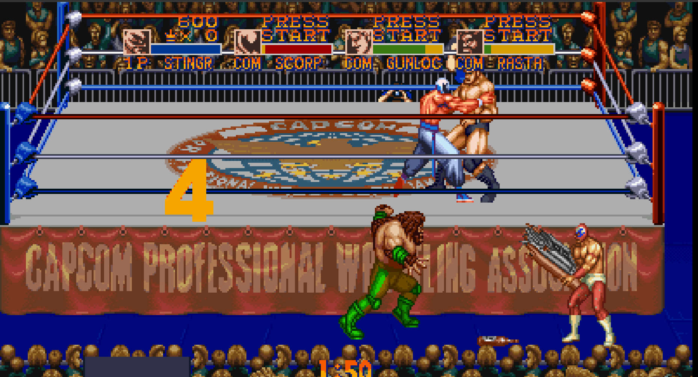

# SSM Online

**Saturday Night Slam Masters** (SNES, Capcom, 1994), playable online with friends, plus modes
the original never had: ring-out in 2vs2, 4vs4 on a wider ring.

The game runs from its own code: the server holds your ROM dump, and the client translates the
ROM's 65816 code to JavaScript as it runs. There is no emulator. The fighting is the
original's, frame for frame. New modes replace single routines with TypeScript. No game data
is included in this repository.



The new modes are not perfect yet: the camera and some sprites still have small visual glitches,
which will be fixed.

## Run

Requirements: Node 22.12+ and your own dump of the USA ROM (see `roms/README.md`).

```sh
npm install
cp .env.example .env    # optional: ROM path, port
npm start               # builds the client and serves it on port 8790
```

The server prints its addresses. Friends on the same LAN or VPN (Radmin VPN works) open
`http://<address>:8790`. For development, `npm run dev` starts the same server with hot reload.

## Roadmap

- [x] Translated game: boots and runs, deterministic, checked against the emulator
- [x] Cycle timing: frames match the emulator to the clock, from power-on
- [x] Picture (PPU renderer) and controls: a local match in the browser (keyboard, gamepads)
- [x] Sound: SPC700 + DSP running the original driver, sample for sample with the emulator
- [x] Online play with rollback netcode
- [x] 2 vs 2 in the full arena: out of the ring, on the floor, with the ringside items, count-out
- [x] Wider screen (16:9) and full-height picture in the full arena, for 2 vs 2 and 1 vs 1
- [x] Multitap: up to four human players, local or online
- [x] Game Mode Select with 1 VS 1 to 4 VS 4 (3 VS 3 and 4 VS 4 play as 2 VS 2 for now)
- [ ] 3 vs 3, 4 vs 4

See `docs/architecture.md` for how it works.
